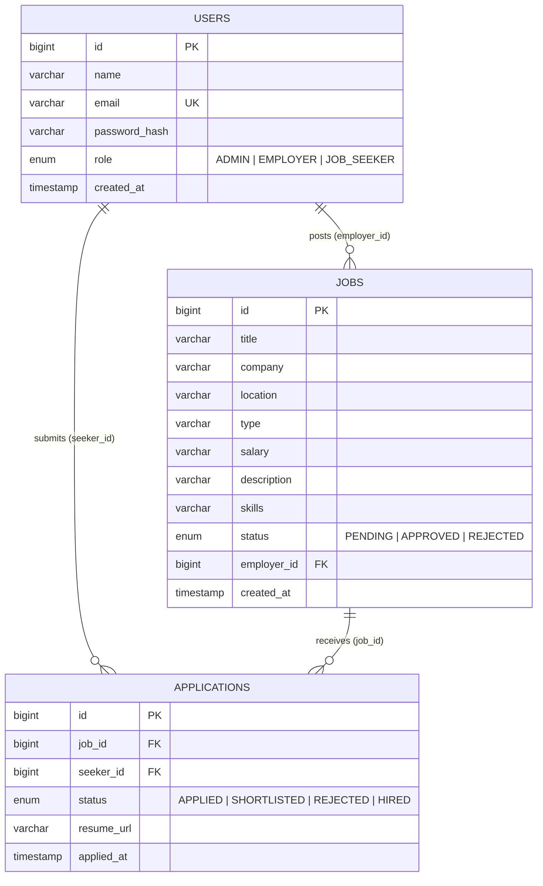

# JobHub Portal — Design Document

## 1. Problem statement
Job seekers, employers and recruiting staff currently coordinate through scattered e-mails and
spreadsheets: employers cannot easily publish and manage vacancies, seekers cannot search and track
applications in one place, and nobody vets listings before they go public.

**JobHub Portal** is a web application that centralises this: employers submit vacancies, an
administrator approves them before they become visible, seekers search and apply, and employers
review and update the status of applicants.

## 2. Users and requirements

| Role | Can do |
|------|--------|
| Visitor (not logged in) | Browse and search approved jobs; register; log in |
| Job seeker | Apply once per job; see own applications and their status |
| Employer | Post jobs (start as *pending*); list/delete own jobs; view applicants and mark them *shortlisted / rejected / hired* |
| Admin | See all users and all jobs; approve or reject jobs; delete any job |

Functional rules: a job is public only when `APPROVED`; a seeker can apply to a job only once;
deleting a job removes its applications; employers can only manage their own jobs.
Non-functional: passwords never stored in plain text, every state-changing call requires a login,
all input validated server-side, consistent JSON error messages.

## 3. Architecture

```
 Browser (React, :5173)
     │  fetch /api/...   (Vite proxy, same-origin, session cookie)
     ▼
 ┌──────────────────────────── Servlet container (Jetty / Tomcat, :8080) ───────────────────────────┐
 │  AuthFilter  ──►  UserServlet / JobServlet / ApplicationServlet   (extend BaseServlet)          │
 │                          │  parse request, call service, write JSON                              │
 │                          ▼                                                                       │
 │                   Services (UserService, JobService, ApplicationService)                         │
 │                          │  business rules, validation, authorisation                            │
 │                          ▼                                                                       │
 │                   DAO interfaces  ──►  Jdbc*Dao  (PreparedStatement / ResultSet)                 │
 └──────────────────────────────────────────────┬───────────────────────────────────────────────────┘
                                                ▼
                                           MySQL 8 (InnoDB)
```

Why layers: servlets contain no business logic and services contain no HTTP or SQL, so each layer
can be replaced or tested alone (the self-test swaps the JDBC DAOs for in-memory ones).

## 4. Database design (ER diagram)


Integrity is enforced by the database itself (see `database/schema.sql`): unique e-mail,
`UNIQUE(job_id, seeker_id)` so nobody applies twice (even under concurrent requests),
foreign keys with `ON DELETE CASCADE`, and `ENUM` columns for roles and statuses.

## 5. REST API

| Method & path | Who | Purpose |
|---|---|---|
| POST `/api/users/register` | public | Create seeker/employer account (admin cannot self-register) and log in |
| POST `/api/users/login` | public | Log in (new session; lockout after 5 failures) |
| POST `/api/users/logout` | user | End session |
| GET `/api/users/me` | user | Current user |
| GET `/api/users` | admin | List users |
| PUT `/api/users/{id}` | self / admin | Edit name and e-mail |
| GET `/api/jobs?q=` | public | Search approved jobs |
| GET `/api/jobs/all` | admin | All jobs |
| GET `/api/jobs/employer/{id}` | that employer / admin | Employer's jobs |
| POST `/api/jobs` | employer | Post job (status forced to PENDING, owner = session user) |
| PUT `/api/jobs/{id}/status?value=` | admin | Approve / reject |
| DELETE `/api/jobs/{id}` | owner / admin | Delete job and its applications (one transaction) |
| POST `/api/applications` | seeker | Apply (seeker = session user) |
| GET `/api/applications/seeker/{id}` | that seeker / admin | My applications (with job title) |
| GET `/api/applications/job/{id}` | job's employer / admin | Applicants (name, e-mail) |
| PUT `/api/applications/{id}/status?value=` | job's employer / admin | Shortlist / reject / hire |

Errors are always `{"message": "..."}` with 400, 401, 403, 404, 409, 415, 429 or 500.

## 6. Core Java concepts used (and where)

| Concept | Where |
|---|---|
| Encapsulation | Private fields + getters/setters in every `model` class |
| Inheritance, abstract class, polymorphism | `User` → `Admin`, `Employer`, `JobSeeker` (each overrides `getRole()` / `permissions()`); `BaseServlet` → the three servlets |
| Interfaces | `Dao`, `UserDao`, `JobDao`, `ApplicationDao`, `JsonSerializable`; `Filter`, `ServletContextListener` |
| Generics | `Dao<T, ID>` |
| Enums, switch expressions | `Role`, `JobStatus`, `ApplicationStatus`; `User.create(...)` factory |
| Records | `ApplicationView` |
| Custom exception hierarchy | `exception/` — `JobHubException` (carries HTTP status) and subclasses; `DataAccessException` wraps `SQLException` |
| Exception handling | `BaseServlet.service()` maps exceptions to JSON errors; try-with-resources in every DAO |
| Collections, `Optional`, streams | `Map`/`List` in `Json`; `Optional` in DAOs/services; streams in `BaseServlet.segments`, `AppInitListener` |
| Concurrency | `LoginThrottle` — `ConcurrentHashMap.compute`, `volatile` (servlets are multi-threaded) |
| Strings, regex, I/O | `Validation` (regex), `Http.readJson` (readers), `Json` (hand-written parser/writer), `AppInitListener` (reads `schema.sql`) |
| Cryptography / security API | `Passwords` — `SecureRandom`, PBKDF2, constant-time compare |
| Serialization | `User implements Serializable` (stored in `HttpSession`) |

## 7. JDBC (database integration)

All in `dao/jdbc/` and `util/Db`:
- `DriverManager.getConnection` with settings from `db.properties` / environment variables.
- `PreparedStatement` for **every** query (injection-safe); `LIKE` wildcards typed by users are escaped.
- `ResultSet` mapping to objects; `Statement.RETURN_GENERATED_KEYS` for auto-increment ids.
- Multi-table **JOIN** (`applications ⋈ jobs ⋈ users`) for applicant lists.
- **Transaction**: `JdbcJobDao.deleteById` turns off auto-commit, deletes applications then the job, commits — or rolls back on error.
- Constraint violations (`SQLIntegrityConstraintViolationException`, MySQL error 1062) are translated into meaningful `409 Conflict` errors.
- Schema creation via JDBC at start-up (`AppInitListener` executes `schema.sql`).

## 8. Servlets and web integration

- `UserServlet`, `JobServlet`, `ApplicationServlet` extend `HttpServlet` (through `BaseServlet`) and implement `doGet`, `doPost`, `doPut`, `doDelete`; mapped to `/api/users/*`, `/api/jobs/*`, `/api/applications/*` in `WEB-INF/web.xml`.
- `AuthFilter` (`/api/*`) is the servlet **filter chain** entry point: authentication check plus `Cache-Control` / `nosniff` headers.
- `AppInitListener` is a `ServletContextListener`: builds the schema and seeds demo data on deployment.
- **Sessions**: `HttpSession` holds the logged-in `User`; a new session is created at login (session-fixation protection); 30-minute timeout; `HttpOnly` cookie configured in `web.xml`.
- JSON in/out, correct HTTP status codes, request-body size limit, `Content-Type` check.
- Integration with the React frontend through the Vite dev proxy (same origin, so the cookie is sent).

## 9. Testing

`backend/selftest/SelfTest.java` drives the **real** servlets, filter, services and models through
about 90 checks (registration rules, login lockout, role and ownership checks, duplicate applications,
filter behaviour, JSON parser edge cases, password hashing) using in-memory DAOs and fake
request/response objects — possible because the DAOs are interfaces.

To run it (after `mvn compile`; the servlet API jar comes from your local Maven repository):
```bash
cd backend
SERVLET_JAR=$(find ~/.m2 -name 'jakarta.servlet-api-5.0.0.jar' | head -1)
javac -cp target/classes:$SERVLET_JAR -d /tmp/selftest selftest/SelfTest.java
java  -cp /tmp/selftest:target/classes:$SERVLET_JAR SelfTest
```
The JDBC code and SQL were reviewed but need a MySQL server to execute; check them by running the app
and exercising each role once (suggested walkthrough below).

**Manual walkthrough**
1. Log in as employer → post a job → it shows as PENDING and is absent from the public Jobs page.
2. Log in as admin → approve it → it appears on the Jobs page.
3. Log in as seeker → apply → applying again shows "already applied".
4. Employer → Applicants → Shortlist; seeker's dashboard shows SHORTLISTED.
5. Employer deletes the job → seeker's application disappears.

## 10. Future work
Connection pooling, CSRF tokens, resume file upload, e-mail notifications, pagination, JUnit/Testcontainers tests against MySQL.
